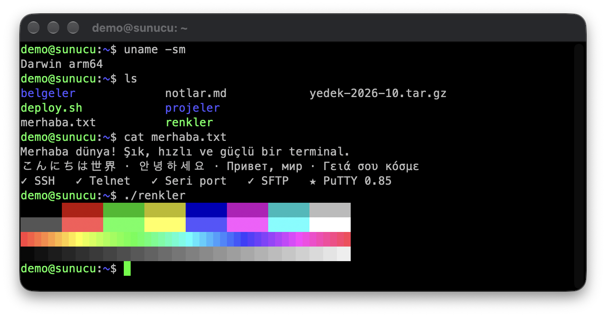
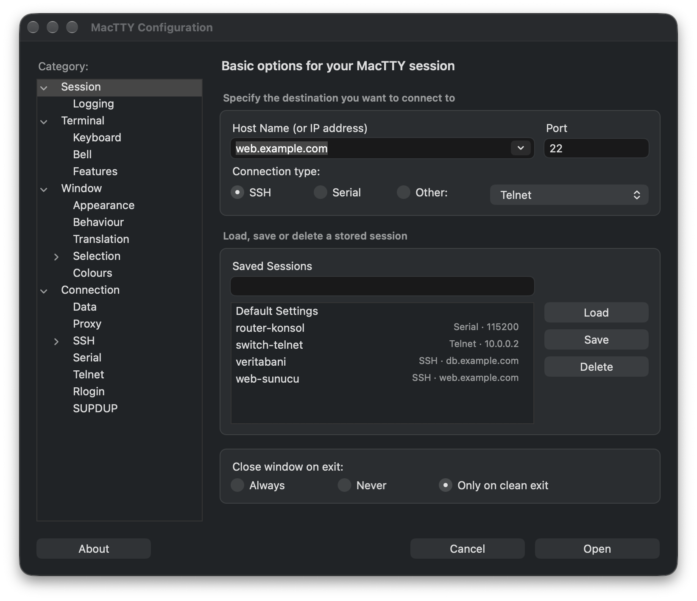
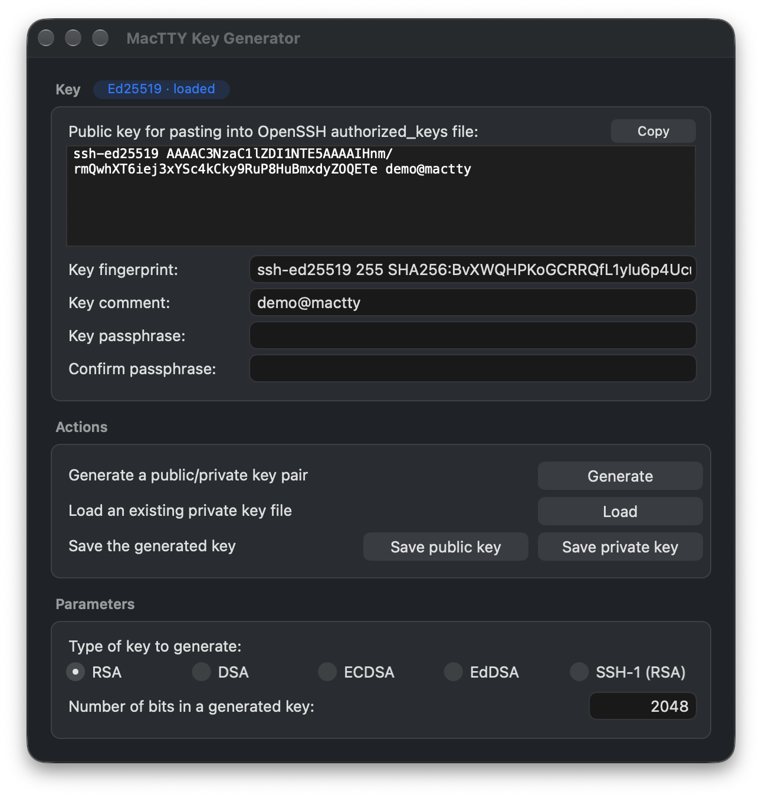

<p align="center">
  
</p>

<h1 align="center">MacTTY</h1>

<p align="center">
  <b>PuTTY, Mac'in kendi arayüzüyle.</b><br>
  SSH, Telnet, Rlogin, Raw ve seri konsol bağlantıları; PuTTY 0.85'in çekirdeği üzerinde yerel bir macOS uygulaması.
</p>

<p align="center">
  <a href="https://github.com/tallat1/MacTTY/releases/latest"></a>
  
  
  
  <a href="LICENSE"></a>
</p>

<p align="center">
  <a href="https://github.com/tallat1/MacTTY/releases/latest"><b>İndir</b></a>
  &nbsp;·&nbsp; <a href="#kurulum">Kurulum</a>
  &nbsp;·&nbsp; <a href="#özellikler">Özellikler</a>
  &nbsp;·&nbsp; <a href="#kullanım">Kullanım</a>
  &nbsp;·&nbsp; <a href="#kaynaktan-derleme">Kaynaktan derleme</a>
</p>

<p align="center">
  
</p>

## Neden MacTTY?

PuTTY'nin resmi bir yerel Mac sürümü yok. MacTTY bu boşluğu PuTTY'yi
yeniden yazmadan doldurur: bağlantı, şifreleme, terminal emülasyonu ve
ayarlar PuTTY'nin kendi C kodudur, yalnızca pencere ve diyalog katmanı
AppKit ile yazılmıştır.

- **Aynı PuTTY.** Ayar kutusundaki her seçenek PuTTY'deki yerinde ve
  aynı adla durur. Davranış, varsayılanlar ve hata mesajları PuTTY'ninkidir.
- **Tanıdık düzen, Mac kontrolleri.** PuTTY Configuration penceresinin
  kategori ağacı ve panelleri korunmuştur. Düğmeler, listeler ve menüler
  macOS'un kendi kontrolleridir. Uygulama Karanlık Mod'a uyar, metni
  Retina ekranda keskin çizer. İkonlar Apple'ın katmanlı ikon biçimindedir:
  macOS 26 ve sonrasında Liquid Glass ile çizilir, koyu, şeffaf ve renkli
  ikon stillerine uyar.
- **Hepsi tek pakette.** MacTTYgen (PuTTYgen), Pageant ve `plink`, `pscp`,
  `psftp`, `puttygen`, `pageant` komut satırı araçları uygulamanın içinde
  gelir.
- **Universal ve hafif.** Apple silicon ve Intel için tek uygulama, yaklaşık
  6,5 MB'lık bir DMG. AES ve SHA donanım hızlandırması iki mimaride de açık.

## Kurulum

**Gereksinimler:** macOS 14 Sonoma veya üstü · Apple silicon ya da Intel
işlemcili bir Mac.

1. [Son sürüm sayfasından](https://github.com/tallat1/MacTTY/releases/latest)
   `MacTTY-<sürüm>.dmg` dosyasını indirin.
2. DMG'yi açın ve **MacTTY**'yi **Applications** klasörüne sürükleyin.
3. MacTTY'yi Applications klasöründen ya da Launchpad'den açın.

> [!IMPORTANT]
> **İlk açılışta macOS onay ister.** MacTTY ücretsiz bir açık kaynak
> projedir; Apple Developer ID ile imzalanmamış ve Apple'ın noter onayından
> geçmemiştir (ad-hoc imzalı). Bu yüzden macOS ilk açılışta uygulamanın
> doğrulanamadığını söyler. Bir kez onaylamanız yeterli:
>
> 1. Uyarıda **Bitti**'ye basın.
> 2. **Sistem Ayarları › Gizlilik ve Güvenlik**'i açın. En altta
>    "MacTTY engellendi" satırındaki **Yine de Aç**'a basın ve parolanızla
>    onaylayın.
>
> macOS 14'te Finder'da MacTTY'ye Control-tıklayıp **Aç** demek de
> yeterlidir. MacTTYgen ya da Pageant menüden ilk açıldığında aynı uyarıyı
> verirse aynı adımı onlar için de bir kez yapın.

<details>
<summary><b>Terminal ile tek seferde onaylamak</b></summary>

<br>

Uygulamayı ve içindeki araçları karantinadan çıkarır:

```bash
xattr -dr com.apple.quarantine /Applications/MacTTY.app
```

</details>

<details>
<summary><b>İndirilen dosyayı doğrulamak</b></summary>

<br>

Her sürümde DMG'nin yanında bir `.sha256` dosyası bulunur. Çıktılar
aynı olmalı:

```bash
shasum -a 256 MacTTY-1.0.1.dmg
```

</details>

## Özellikler

### Bağlantılar

| Bağlantı | Neler var |
|---|---|
| **SSH** | SSH-2 ve SSH-1; PuTTY'nin tüm şifre, anahtar değişimi ve host key algoritmaları; PPK anahtarları ve sertifikalar; Pageant ve ssh-agent; agent forwarding; yerel, uzak ve dinamik port yönlendirme; X11 yönlendirme; bağlantı paylaşımı |
| **Seri hat** | `/dev/cu.*` portları; hız, veri biti, durma biti, parite ve akış kontrolü. Takılı portlar cihaz adıyla listelenir, ör. `FT232R USB UART · FTDI` |
| **Telnet, Rlogin, SUPDUP, Raw** | PuTTY'deki tüm seçenekleriyle |
| **Proxy** | HTTP, SOCKS 4/5, Telnet, SSH atlama sunucusu ve yerel komut |

### Terminal

- PuTTY'nin xterm uyumlu terminal emülatörü: 16, 256 ve 24-bit renk;
  kalın, altı çizili, ters, üstü çizili ve soluk metin.
- Unicode: Türkçe karakterler, geniş CJK karakterleri, birleşik
  karakterler, çift genişlik ve çift yükseklik satırları.
- Kaydırma geçmişi ve fare raporlama (`vim`, `htop`, `mc` gibi
  programlarda fare çalışır).
- Pencere boyutu değişince yeni boyut sunucuya gider. İsterseniz ızgara
  sabit kalır, yazı tipi büyür.
- PuTTY'deki gibi seçilen metin kendiliğinden kopyalanır, sağ tık
  yapıştırır. ⌘C ve ⌘V de çalışır.

### Oturumlar

<p align="center">
  
</p>

- Kayıtlı oturumlar PuTTY'nin Unix sürümüyle aynı biçimde
  `~/.putty/sessions` altında durur. Listede her oturumun yanında
  protokolü ve hedefi görünür.
- Son bağlantılar **Session › Open Recent** menüsünde ve Dock simgesinin
  menüsünde (Windows PuTTY'deki Jump List'in karşılığı). Host alanı son
  bağlanılan host'ları önerir.
- PuTTY'nin oturum menüsü hem menü çubuğunda hem terminalde Ctrl+tıkla:
  Event Log, Special Command, New/Duplicate/Restart Session, Saved
  Sessions, Change Settings, Copy All to Clipboard, Clear Scrollback, Reset
  Terminal, Full Screen.
- Bağlantı kapanınca başlıkta "(inactive)" yazar, pencerenin altında
  **Restart Session** ve **Close** düğmeleri belirir.

### Güvenlik

- Host key uyarıları PuTTY'nin kendi metinleriyle gelir. Host ve parmak
  izi ayrı kutularda görünür, parmak izi tek tıkla kopyalanır, ayrıntılar
  aynı pencerede açılır.
- Bilinen host anahtarları `~/.putty/sshhostkeys` altında tutulur.

### MacTTYgen ve Pageant

<p align="center">
  
</p>

İkisi de MacTTY uygulama menüsünden açılır ve Windows'taki gibi ayrı
programlardır.

- **MacTTYgen**, PuTTYgen'in karşılığıdır. RSA, DSA, ECDSA, EdDSA ve
  SSH-1 anahtarı üretir. Rastgelelik fareyle toplanır. Anahtarları PPK
  olarak kaydeder, OpenSSH ve ssh.com biçimlerine aktarır ya da bu
  biçimlerden alır, sertifika ekler ve çıkarır.
- **Pageant**, PuTTY'nin SSH ajanıdır. Menü çubuğunda yaşar; anahtar
  listesi penceresinden anahtar ekler, şifreli yükler ve kaldırırsınız.
  Şifreli yüklenen anahtarın parolası ilk kullanıldığında sorulur.
  Pageant çalışırken MacTTY onu kendiliğinden kullanır. OpenSSH araçlarının
  (`ssh`, `ssh-add`, `git`) da kullanması için:

  ```bash
  export SSH_AUTH_SOCK=~/.putty/pageant.sock
  ```

  ya da `~/.ssh/config` dosyasına `IdentityAgent ~/.putty/pageant.sock`
  satırını ekleyin.

### Komut satırı araçları

`plink`, `pscp`, `psftp`, `puttygen` ve `pageant` uygulamanın içinde gelir
ve MacTTY ile aynı kayıtlı oturumları kullanır. `PATH`'e eklemek için
`~/.zshrc` dosyasına:

```bash
export PATH="/Applications/MacTTY.app/Contents/Resources/bin:$PATH"
```

## Kullanım

MacTTY, PuTTY gibi ayar penceresiyle açılır. Host'u yazıp **Open**'a
basmanız yeterli. Kayıtlı bir oturumu çift tıklamak onu doğrudan açar.

PuTTY'nin komut satırı seçenekleri de geçerlidir:

```bash
/Applications/MacTTY.app/Contents/MacOS/MacTTY -ssh -l kullanici sunucu.example.com
```

```bash
/Applications/MacTTY.app/Contents/MacOS/MacTTY -load "Kayıtlı oturum"
```

**Mac klavyesinde PuTTY tuşları**

| PuTTY (Windows) | MacTTY |
|---|---|
| Alt (Meta) | Option ("Option key acts as Meta", varsayılan açık) |
| Insert | Help tuşu (Shift+Help yapıştırır, Ctrl+Help kopyalar) |
| Ctrl+Break | Ctrl+F15 |
| Num Lock | Sayısal tuş takımındaki Clear |
| Alt+Enter (tam ekran) | Option+Return ("Full screen on Option-Return") |
| Alt+F4 | ⌘W ("Window closes on Command-W") |
| Sistem menüsü | Ctrl+tık; "macOS" fare kipinde sağ tık |

## Kaynaktan derleme

Gerekenler: Xcode 26 veya üstü (uygulama ikonlarını `actool` derler),
CMake ve Ninja.

```bash
brew install cmake ninja
```

```bash
./build.sh
```

Uygulama `build/MacTTY.app` olarak çıkar. `./build.sh debug` hata
ayıklama derlemesi yapar.

Dağıtım için `./release.sh` kullanılır. Betik her mimariyi ayrı derler
(`build-arm64/`, `build-x86_64/`), ikilileri `lipo` ile birleştirir,
ad-hoc imzalar ve `dist/` altına DMG ile SHA-256 dosyasını yazar. Ardından
her ikilinin iki mimariyi de içerdiğini, en düşük macOS sürümünün 14.0
olduğunu ve imzaların geçerli olduğunu denetler. Sürüm numarası `VERSION`
dosyasındadır.

<details>
<summary><b>Proje yapısı</b></summary>

<br>

```
putty/      PuTTY 0.85 kaynağı (sha512 doğrulanmış resmi sürüm)
build.sh    geliştirme derlemesi
release.sh  universal, imzalı DMG
VERSION     MacTTY sürümü (Info.plist'lere ve About kutularına gider)
docs/       README görselleri
macos/      Cocoa ön yüzü
  inject.cmake     PuTTY'nin CMake'ine kendi hedefimizi ekler
  targets.cmake    MacTTY.app, MacTTYgen.app ve Pageant.app hedefleri
  eventloop.m      uxsel / zamanlayıcı / toplevel callback → CFRunLoop
  TerminalView.m   CoreText çizimi, klavye ve fare çevirisi
  Session.m        TermWin, Seat, LogPolicy; oturum yaşam döngüsü
  ConfigDialog.m   dialog.h kontrol kutusu çizici ve dlg_* API
  Dialogs.m        güvenlik uyarıları, Event Log, About
  config-mac.c     Mac'e özgü ayar seçenekleri (windows/config.c karşılığı)
  platform-mac.m   platform varsayılanları, seri port listesi
  recent.m         son oturumlar
  AppDelegate.m    menü çubuğu, açılış, komut satırı
  Keygen.m         MacTTYgen (windows/puttygen.c karşılığı)
  Pageant.m        Pageant ön yüzü (windows/pageant.c karşılığı)
  pageant-socket.c Pageant soketinin yeri; MacTTY'nin ajan seçimi
  tools.m          MacTTYgen ve Pageant'ın ortak diyalogları
  icons/           uygulama ikonları (Icon Composer belgeleri, .icon)
```

PuTTY kaynağında tek bir değişiklik vardır: `putty/unix/platform.h`
içindeki `MACTTY` profili (pano davranışı ve Option tuşunun Meta ayarı).
PuTTY'nin yeni bir sürümüne geçmek için `putty/` klasörünü yenisiyle
değiştirip bu yamayı yeniden uygulamak yeterlidir
(`git log -p putty/unix/platform.h`).

MacTTYgen ve Pageant'ın ayrı uygulama olmasının iki nedeni var. Pageant
terminal pencereleri kapandıktan sonra da çalışmalı ve Dock simgesi
olmadan menü çubuğunda durmalı. MacTTYgen anahtarı ayrı bir iş
parçacığında üretir ve PuTTY'nin rastgele sayı havuzu iş parçacığı
güvenli değildir, bu yüzden canlı SSH oturumlarıyla aynı süreçte
olmamalı.

</details>

## Bilinen sınırlar

- Uygulama Apple Developer ID ile imzalı değil. İlk açılışta bir kez
  onay gerekir ([Kurulum](#kurulum)).
- Universal derleme Intel Mac'ler ve macOS 14 için hazırlandı, ancak bu
  ortamlarda henüz denenmedi.
- Uzaktan yazdırma (remote printing) ve X11 yönlendirme henüz denenmedi.
  X11 yönlendirme için XQuartz gibi bir X sunucusu gerekir.

Bir sorunla karşılaşırsanız [issue açabilirsiniz](https://github.com/tallat1/MacTTY/issues).

## Lisans ve teşekkür

MacTTY [MIT lisansıyla](LICENSE) dağıtılır. Uygulamanın çekirdeği olan
[PuTTY](https://www.chiark.greenend.org.uk/~sgtatham/putty/) de MIT
lisanslıdır (`putty/LICENCE`); copyright 1997-2026 Simon Tatham ve
katkıda bulunanlar.

MacTTY bağımsız bir projedir; PuTTY ekibi tarafından geliştirilmez ve
onaylanmamıştır.
