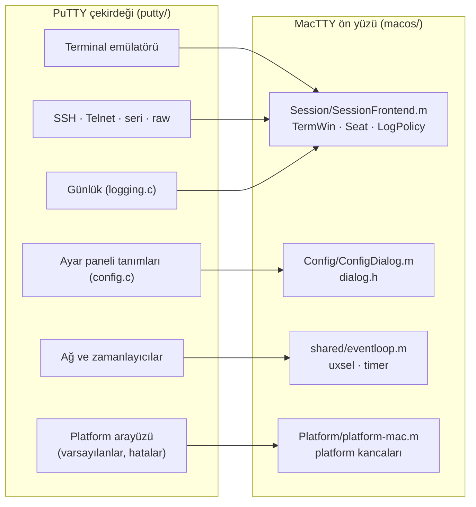
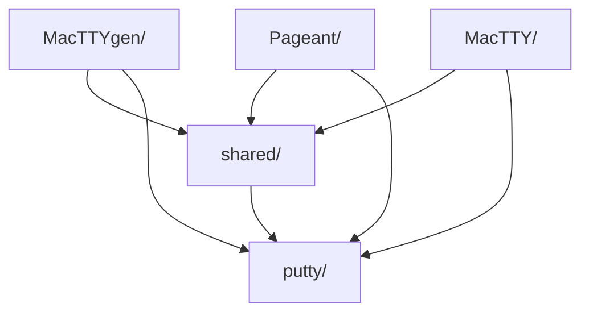
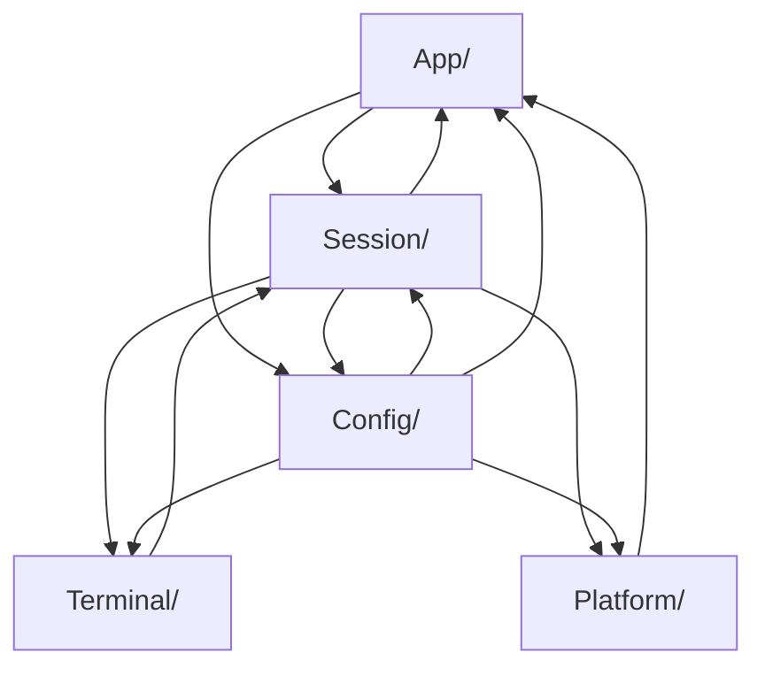

# MacTTY mimarisi

Bu belge kodun nasıl bölündüğünü, parçaların birbirine nasıl bağlandığını
ve yeni bir şeyin nereye yazılacağını anlatır.

## Temel fikir

MacTTY, PuTTY'yi yeniden yazmaz. SSH, Telnet, seri hat, şifreleme,
terminal emülatörü ve ayarlar PuTTY 0.85'in kendi C kodudur ve
`putty/` klasöründe olduğu gibi durur. MacTTY yalnızca PuTTY'nin bir
"ön yüz"den beklediği şeyleri AppKit ile sağlar: pencereler, çizim,
klavye ve fare, diyaloglar, olay döngüsü.

PuTTY bu ön yüzle birkaç tanımlı arayüzden konuşur. Her arayüzün
MacTTY'de tek bir sahibi vardır:



| PuTTY arayüzü | Ne için | MacTTY'deki sahibi |
|---|---|---|
| `TermWin` | Terminalin çizimi, imleç, pano, pencere başlığı | `MacTTY/Session/SessionFrontend.m` → `TerminalView` |
| `Seat` | Bağlantının kullanıcıyla konuşması: çıktı, parola, host key | `MacTTY/Session/SessionFrontend.m` → `SecurityPrompt` |
| `LogPolicy` | Olay günlüğü, log dosyası sorusu | `MacTTY/Session/SessionFrontend.m` → `EventLog` |
| `dialog.h` (controlbox, `dlg_*`) | Ayar penceresinin panelleri ve kontrolleri | `MacTTY/Config/ConfigDialog.m` |
| uxsel, zamanlayıcı, toplevel callback | Soketler ve zamanlayıcılar | `shared/eventloop.m` (CFRunLoop) |
| Platform kancaları (`platform_default_*`, `nonfatal`, …) | Varsayılan ayarlar, ölümcül hatalar | `MacTTY/Platform/platform-mac.m` |

## Depo düzeni

```
MacTTY/
├── putty/                 PuTTY 0.85 kaynağı (tek yama: unix/platform.h)
├── macos/                 MacTTY'nin kendi kodu
│   ├── cmake/             derleme: PuTTY'nin CMake'ine kanca, hedefler, ikon
│   ├── shared/            birden çok uygulamanın kullandığı kod
│   ├── MacTTY/            terminal uygulaması
│   ├── MacTTYgen/         anahtar üretici (PuTTYgen karşılığı)
│   └── Pageant/           SSH ajanı
├── docs/                  bu belge ve README görselleri
├── build.sh               geliştirme derlemesi
├── release.sh             universal, imzalı DMG
└── VERSION                MacTTY sürümü
```

Üç uygulama ayrı programdır (Windows'taki PuTTY, PuTTYgen ve Pageant
gibi). MacTTYgen ve Pageant, `MacTTY.app/Contents/Applications` içine
derlenir ve MacTTY ile birlikte taşınır.

### `macos/shared/`

| Dosya | Sorumluluk | Kullanan |
|---|---|---|
| `eventloop.{h,m}` | PuTTY'nin olay modelini (soket, zamanlayıcı, geri çağrı) Cocoa'nın run loop'una bağlar | MacTTY, Pageant |
| `agent-socket.{h,c}` | Pageant soketinin sabit yolu; MacTTY'nin hangi ajanı kullanacağı | MacTTY, Pageant |
| `notifications.h` | Uygulamalar arası bildirim adları (Pageant'tan MacTTY'de oturum açma) | MacTTY, Pageant |
| `companion.{h,m}` | MacTTYgen ve Pageant'ın ortak diyalogları: mesaj kutusu, parola sorusu, About, menü yardımcıları | MacTTYgen, Pageant |

### `macos/MacTTY/`

| Klasör | Dosya | Sorumluluk |
|---|---|---|
| `App/` | `main.m` | Giriş noktası |
| | `AppDelegate.{h,m}` | Menü çubuğu, açılış, komut satırı, Dock menüsü |
| | `alerts.{h,m}` | Uygulama genelinde mesaj kutusu ve About kutusu |
| `Session/` | `Session.{h,m}` | Bir terminal penceresi ve arkasındaki oturum: pencere, boyut, kaydırma çubuğu, bağlantı yaşam döngüsü, ayar değişikliği |
| | `SessionFrontend.m` | Oturumun PuTTY'ye görünen yüzü: TermWin, Seat, LogPolicy |
| | `SessionInternal.h` | Yalnız `Session.m` ile `SessionFrontend.m`'in paylaştığı iç arayüz |
| | `SecurityPrompt.{h,m}` | Host key ve zayıf şifreleme soruları, log dosyası sorusu |
| | `EventLog.{h,m}` | Oturumun Event Log penceresi |
| | `recent-sessions.{h,m}` | Son oturumlar, kayıtlı oturum özetleri |
| `Terminal/` | `TerminalView.{h,m}` | Terminalin CoreText ile çizimi, klavye ve fare çevirisi, yazı tipleri |
| `Config/` | `ConfigDialog.{h,m}` | PuTTY'nin controlbox'ını AppKit ile çizen ayar penceresi ve `dlg_*` API'si |
| | `config-mac.{h,c}` | Mac'e özgü ayar panelleri ve kontroller (`windows/config.c` karşılığı) |
| `Platform/` | `platform-mac.{h,m}` | PuTTY'nin platform kancaları, seri port listesi |

Uygulama kaynakları da kendi klasöründedir: `Info.plist.in` ve ikon
(`MacTTY.icon`, Icon Composer belgesi).

### `macos/MacTTYgen/` ve `macos/Pageant/`

Her biri tek bir `.m` dosyasıdır (`Keygen.m`, `Pageant.m`), yanında
`Info.plist.in` ve ikonu. Bu bilinçli bir seçim: ikisi de tek bir global
durumu paylaşan bütünlüklü programlardır (PuTTY'deki karşılıkları
`windows/puttygen.c` ve `windows/pageant.c` da tek dosyadır). Dosyaların
içi başlıklı bölümlere ayrılmıştır; bölmek, onlarca iç bildirimi bir
başlığa taşımaktan başka bir şey kazandırmaz.

## Bağımlılık kuralları



1. **`shared/` hiçbir uygulamanın koduna bağlı değildir.** Yalnız PuTTY'yi
   ve sistem çerçevelerini kullanır.
2. **MacTTYgen ve Pageant, `MacTTY/` klasöründen hiçbir şey almaz.**
   Ortak bir şey gerekiyorsa `shared/`'a taşınır.
3. **PuTTY değiştirilmez.** Tek istisna `putty/unix/platform.h` içindeki
   `MACTTY` profilidir. PuTTY'nin yeni sürümüne geçmek için `putty/`
   yenisiyle değiştirilip bu yama yeniden uygulanır.
4. **Her modülün bir başlığı vardır ve dışarıya yalnız o başlıktan açılır.**
   Başka bir modülün `.m` dosyasındaki bir şeye ihtiyaç varsa önce o
   modülün başlığına eklenir. Tek istisna `SessionInternal.h`'tir; yalnız
   oturumun iki dosyası içindir.

MacTTY içindeki modüller birbirini başlıkları üzerinden kullanır. Şema
koddaki `#include` satırlarından çıkarılmıştır (ok "kullanır" demektir):



Bir masaüstü uygulamasında pencere, görünüm ve diyaloglar birbirini
çağırdığı için bu modüller katman değil, birbirine başlıklarla bağlı
parçalardır. İki yaygın bağ: `App/alerts` (mesaj kutusu) her yerden
çağrılır, PuTTY'nin hata bildirimleri de (`nonfatal`, `modalfatalbox`)
oraya düşer; `Terminal/` ile `Session/` ise bir pencerenin iki yarısıdır.

## Adlandırma

| Ne | Kural | Örnek |
|---|---|---|
| Objective-C sınıfı içeren dosya | Ana sınıfın adı, `MT` ön eki olmadan | `Session.m` → `MTSession` |
| Sınıfsız, C arayüzlü modül | PuTTY gibi küçük harf ve tire | `eventloop.m`, `config-mac.c`, `recent-sessions.m` |
| Objective-C sınıfları | `MT` ön eki | `MTTerminalView`, `MTSecurityPrompt` |
| PuTTY arayüzlerinin uygulamaları | `mac_` ön eki | `mac_seat_output`, `mac_draw_text` |
| MacTTY modülleri arası C API | `mactty_` ön eki | `mactty_config_box`, `mactty_select_agent` |
| MacTTYgen ve Pageant ortak yardımcıları | `mt_` ön eki | `mt_passphrase_prompt` |
| Tanımlayıcılar | İngilizce; Türkçe yalnız kullanıcıya görünen metinde | |

`#include` satırları uygulama ya da `macos/` kökünden yazılır:
`"Session/Session.h"`, `"shared/eventloop.h"`. Böylece bir dosyanın ilk
satırları onun programın hangi parçalarına bağlı olduğunu gösterir.

## Derleme akışı

1. `build.sh`, PuTTY'nin kendi CMake projesini `macos/cmake/inject.cmake`
   kancasıyla yapılandırır. PuTTY'nin kütüphaneleri olduğu gibi derlenir.
2. `inject.cmake`, PuTTY'nin CMake dosyası bitince `targets.cmake`'i
   ekler. Üç uygulamanın kaynak listeleri, bağlandıkları PuTTY
   kütüphaneleri ve `Info.plist`'leri burada tanımlıdır.
3. `app-icon.cmake`, her uygulamanın `.icon` belgesini Xcode'un `actool`
   aracıyla `Assets.car`'a derler (macOS 26+ için katmanlı Liquid Glass
   ikonu, macOS 14/15 için düzleştirilmiş ikon).
4. `release.sh`, Apple silicon ve Intel için iki ayrı derleme yapar,
   ikilileri `lipo` ile birleştirir, ad-hoc imzalar ve DMG üretir.

## Yeni bir şey nereye yazılır?

| İş | Yer |
|---|---|
| Yeni bir Mac'e özgü ayar | `MacTTY/Config/config-mac.c` (paneller PuTTY'nin `config.c`'si gibi tanımlanır; `ConfigDialog.m` kendiliğinden çizer) |
| Bağlantı sırasında sorulan yeni bir soru (Seat) | `MacTTY/Session/SessionFrontend.m` içindeki geri çağrı, diyalog `SecurityPrompt.m`'de |
| Terminal çizimi, klavye, fare | `MacTTY/Terminal/TerminalView.m` |
| Pencere davranışı, menüdeki oturum komutları | `MacTTY/Session/Session.m`, menü `MacTTY/App/AppDelegate.m` |
| Menü çubuğuna yeni öğe | `MacTTY/App/AppDelegate.m` |
| PuTTY'nin istediği yeni bir platform fonksiyonu | `MacTTY/Platform/platform-mac.m` |
| MacTTYgen ve Pageant'ın ikisinin de kullanacağı bir diyalog | `shared/companion.m` |
| Üç uygulamanın da kullanacağı kod | `shared/` altında yeni bir modül (başlığıyla) |

Yeni bir `.m` ya da `.c` dosyası eklendiğinde `macos/cmake/targets.cmake`
içindeki ilgili kaynak listesine yazılır.
